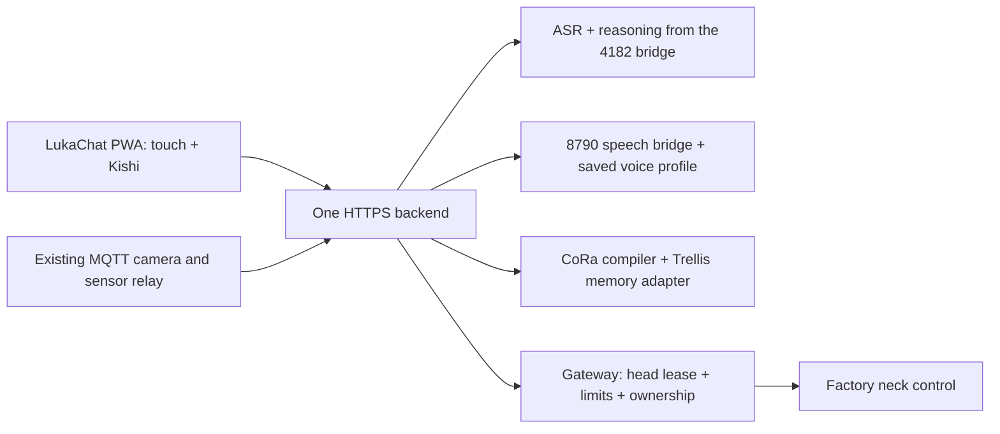

# LukaChat: head controls, camera capture, and the first web test

Inspected against Luka on 2026-11-06. This records the initial head/camera
analysis. Head controls have since been implemented and exercised; see the
[operating notes and live validation](head-controls.md). Initial observations:
[`evidence/lukachat-hardware-2026-11-06.json`](evidence/lukachat-hardware-2026-11-06.json).

## Voice is saved

The accepted voice is **Grayson, Inworld TTS-2, rate 0.85×, pitch −4 semitones**.
[`config/luka-voice.json`](../config/luka-voice.json) is the saved source; the
voice bridge loads it at startup. `npm run voice` starts the bridge, and
`GET /voice-profile` returns the effective settings. The dashboard can still
make temporary comparisons. Pitch compensation and the playback sequencing fix
remain in the bridge.

## What the live inspection established

| Item | Observed on Luka |
| --- | --- |
| Access | SSH via X86 `agi@192.168.4.152` to Orin `agi@192.168.100.110` |
| Orin | `ubuntu-orin`, aarch64; ROS Humble installed |
| Motion controller | Internal `192.168.100.100:56322`; getters return successfully through Orin |
| Neck feedback | `McDataService/GetNeckState`: yaw `idx27_head_joint1`, pitch `idx28_head_joint2`, radians |
| Sample position | Yaw `0.01789` rad (~1.0°), pitch `−0.04446` rad (~−2.5°); these are raw motor values |
| Action during inspection | `McAction_RL_LOCOMOTION_ARM_EXT_JOINT_SERVO`, running |
| Neck owner | `MotionCommandService/GetMotionStatus` reported `is_neck_enable: true`, even while playback status was idle |
| Installed SDK | `/agibot/dev/AimDK/agibot_a2_aimdk-dev2.0`; this identifies the SDK, not the controller firmware |
| Existing sensor relay | `/home/agi/.local/share/luka-sensor-relay/releases/20261103-v6-media/a2_joint_relay.py`, running |

The working SSH path and running sensor relay supersede the historical lockout
and missing-camera statements in the older access/interface notes.

### Cameras and spatial inputs

The existing relay subscribes to factory ROS topics and publishes to the Orin's
MQTT broker (`127.0.0.1:1883`). Inspection subscribed to that broker; it did not
open another video device or start another ROS relay.

| Feed | Verified capture | Implication for the first test |
| --- | --- | --- |
| `a2remote/camera/interactive/h264` | H.264 Main, 1920×1536; 7 packets in 7 s | Forward room view; a useful operator view. The running relay forwards keyframes only for this camera, so this is ~1 image/s, not full motion video. |
| `a2remote/camera/head_front/h264` | H.264 Constrained Baseline, 1280×720; 35 packets in 7 s | ~5 frames/s at the relay. This capture looks downward and is tilted relative to the room; verify mounting/rotation before using it for gaze targeting. |
| `a2remote/depth/head_front` | DEP1, 320×180; 5 messages in 3 s | Depth samples are available. |
| `a2remote/depth/waist_front` | DEP1, 160×120; 5 messages in 3 s | An additional depth view is available. |
| `a2remote/lidar/neck` | LDR1, 8 scans in 3 s; last scan 2,840 points | LiDAR is already available to a bridge. |
| `a2remote/joints` / `a2remote/sensors` | Neck joints, IMU and odometry received | Measured head feedback can accompany each camera view. No SLAM pose was present in the sampled sensor messages. |

The relay also enables waist RGB and both chest RGB feeds; those three were
identified in its running configuration rather than captured in this check.
The configured v2 output argument is empty: the active depth/LiDAR formats are
DEP1/LDR1. A client subscribing only to `/v2` would incorrectly show no data.
These legacy payloads lack the timestamps and calibration metadata needed for
accurate sensor fusion. The source's DEP2/LDR2 implementations are a later
integration option, not an output verified in this session.

Head color/depth and interactive camera intrinsic YAML files exist in
`/agibot/data/param/hal/intrinsic`. Depth-to-color alignment, camera-to-neck
transforms, depth units, and synchronized timestamps still need measurement
before projecting detections into a persistent spatial map. The names of the
feeds alone do not establish which optical frame moves with each neck axis.

Raw H.264 captures and decoded snapshots are in
`/tmp/luka-hardware-inspection/` (`interactive.jpg`, `head_front.jpg`). Raw H.264
does not carry reliable capture timing here; the reported rates above come from
observed MQTT arrivals, not ffprobe's inferred frame-rate field.

### Face follow prototype

LukaChat now has a default-off **Look toward visible faces** switch. It reads
only the existing `a2remote/camera/interactive/h264` feed through a transient
SSH MQTT subscriber, decodes frames locally with FFmpeg, and runs OpenCV YuNet
on the Mac bridge. The largest face above the confidence threshold is used as a
screen-space target; no face embedding or identity is produced and camera
frames are held only in process memory. The detector package and model are
prepared with `npm run face-follow:setup`; the YuNet model comes from the
[OpenCV Zoo face-detection model](https://github.com/opencv/opencv_zoo/tree/main/models/face_detection_yunet).

The follower requires two consecutive face detections, uses the existing 2°
bounded jogs and head lease, and releases control after the face or camera feed
is lost. The relay currently sends about 1 camera frame per second, so this is
slow. More importantly, the `interactive` camera's physical mounting relative
to the moving neck has not been established. The saved 2° head-control captures
do not calibrate that relationship. The menu reports this limitation and the
physical follow behavior remains unvalidated.

## Supported head interfaces

The installed SDK contains `examples/mc/SetNeckCommand.py`, `neck.py`,
`GetNeckState.py`, and the neck-specific motion-player enable/disable scripts.
The message definitions and official [AimDK neck documentation](https://open-eu.agibot.com/docs/en/aimdk/a2/v1_3/dev_guide/07-01-motion_control)
agree on these two routes:

| Path | Use |
| --- | --- |
| HTTP RPC `McMotionService/SetNeckCommand` at MC port 56322 | A target angle pair; the simplest initial button/jog test |
| ROS topic `/motion/control/neck_joint_command`, `sensor_msgs/JointState` | Continuous control; the installed example publishes at 50 Hz |

Documented command limits are yaw **±0.785 rad (~45°)** and pitch
**±0.401 rad (~23°)**. The gateway previously used the visualization model's
±2.2/±0.5 rad travel. Its command contract now uses the narrower vendor limits
for both `head.gaze` and `head.joints`, with regression coverage.

The RPC body carries both axes, so a one-axis jog must preserve the other
measured axis. The SDK includes a timestamped request header with
`ControlSource_SAFE`; how the current authority filters that header remains an
on-unit validation point. An accepted RPC response is not proof of movement.

For the ROS topic, preserve the installed SDK's fixed name order and populate
two zero velocity and effort entries. Its comments warn that omitting those
arrays can destabilize the controller. The supplied example uses pitch `0.5`,
which exceeds its own documented pitch range; build the test from validated
targets rather than executing the example.

### Neck ownership is the important prerequisite

The factory motion player currently owns the neck. The installed SDK provides:

* `MotionCommandService/DisableNeckMotionPlayer`
* `MotionCommandService/EnableNeckMotionPlayer`
* `MotionCommandService/GetMotionStatus` with `is_neck_enable`

These are on MC port 56444. A head test should use the neck-specific handoff and
record the original ownership state. The general motion-player disable route
affects a broader control path and is unnecessary for a neck test. A new motion
action is also unnecessary for the observed current mode. Before any later test,
read these states again rather than assuming today's mode persists.

## First controls in the current web interface

Add a compact **Head test** panel alongside **Speak as Luka** at port 8790,
backed by a narrow head adapter through the existing gateway. The live physical
AimDK adapter currently permits observation only; its simulator gaze controls
are not a hardware write path. Preparation here changes command limits, not that
capability gate.

The panel should show the selected camera, raw measured yaw/pitch, target
yaw/pitch, sample age, and neck owner. Initial controls: **left, right, up,
down, return to start, acquire neck, release neck**. Use degrees in the UI and
radians on the wire. Proposed initial test settings are **2° per click**, with
a relative envelope of **±10° yaw / ±5° pitch**, intersected with the vendor
limits. These smaller settings are proposed test restrictions, not measured
motor capabilities.

Test sequence:

1. Read fresh neck feedback, action and motion-player ownership. Capture the
   raw starting pose; the twin's calibrated display offset is not a command.
2. Acquire an exclusive head lease and request neck-only ownership. Verify
   `is_neck_enable` changed before offering jog controls.
3. Jog yaw by 2° while preserving pitch. Compare measured angle with the target
   and observe the camera. Then return to the captured starting pose. Repeat
   the opposite yaw direction and each pitch direction individually.
4. Re-enable the factory neck owner if it was originally enabled, verify the
   handback, and close the lease.

Only one jog should be outstanding. If the target is accepted but measured
position does not follow, show the discrepancy and investigate ownership rather
than accumulating retries. A return button means the captured start pose, not
an assumed mechanical zero.

The RPC's velocity fields do not provide a verified speed control. Do not label
a duration slider as a physical speed limit yet. Characterize movement and hold
behavior before continuous control. A dropped browser connection stops new
commands but does not prove an already accepted target stops; small jogs bound
the initial test's remaining travel.

### Kishi mapping after the button test

Use the browser [Gamepad API](https://developer.mozilla.org/en-US/docs/Web/API/Gamepad_API/Using_the_Gamepad_API).
First display controller ID, mapping, axes, and buttons and learn the actual
phone/tablet mapping. For standard mapping, the right stick normally supplies
axes 2/3; map horizontal movement to yaw and vertical movement to pitch, with
an invert option. Use a held shoulder/trigger as movement enable.

Proposed tuning: 0.15 stick dead zone, a curved response near center, and a low
initial requested angular rate. Integrate stick velocity into a bounded target
on the backend. For smooth operation, a robot-side 50 Hz publisher is a better
fit than starting an SSH process or HTTP RPC for every browser animation frame.
Joystick release, controller disconnect, page hiding and stale input must cancel
the operator intent; verify the corresponding measured hold behavior on Luka.
On reconnect, require neutral sticks and a fresh enable press.

## LukaChat PWA preparation

Target: one viewport on phone or tablet, with no scrolling conversation page.
Use a `100dvh` layout and safe-area insets: status at the top, the camera/latest
turn in the center, and fixed push-to-talk/head controls at the bottom. Landscape
can place the camera beside the current turn. Older turns and settings should
use explicit page controls instead of an indefinitely growing transcript.

The 4178 page is a static client; inference runs at 4182. Its text path can reuse
`POST /reason`. Its voice path currently uses `/turn`, which includes TTS, and
there is no standalone ASR endpoint. Add an ASR-only endpoint or an explicit
robot-output turn option so a spoken reply is synthesized once, through Luka's
saved voice profile. The UI should report actual ASR/model/output results.

The phone/tablet needs one reachable HTTPS origin with backend proxy routes.
`127.0.0.1` in a phone browser addresses the phone itself. Loopback's secure
context exception does not extend to an ordinary HTTP LAN address; HTTPS
supports microphone access, gamepad access where required, and an installable
PWA. [Secure contexts reference](https://developer.mozilla.org/en-US/docs/Web/Security/Defenses/Secure_Contexts).
Cache the app shell and assets. Head requests and ownership changes must be
network-only and must never be queued or replayed by the service worker.

### CoRa, Trellis and presence

The linked [CoRa repository](https://github.com/emelleme/corachat) already has
turn routing, a ledger, a context compiler and proposed memory claims. Its
README describes a browser-local graph. The separate
[Trellis memory service](https://github.com/emelleme/trellis/blob/main/src/services/trellisMemoryService.ts)
exposes memory selection and `compileContextPackage`; its
[store contract](https://github.com/emelleme/trellis/blob/main/src/services/trellisStore.ts)
uses objects, references and revision checks. These are two integration surfaces,
not an existing shared Luka HTTP memory service.

Prepare an adapter with `appendTurn`, `retrieveContext`, and
`proposeObservation`. Choose one authoritative persistent store so phone and
tablet share Luka's history. Memory can grow in durable storage while retrieval
keeps each model prompt within its context budget. Camera observations should
carry a frame reference, source/receive time, measured head pose, coordinate
frame, confidence and provenance. Face enrollment, object recognition and a
spatial map are later consumers of those observations.

Presence can later add gaze and small acknowledgement gestures through the same
head controller. Manual Kishi input should take priority, with automatic gaze
resuming only after the operator releases control. First verify camera geometry,
head ownership, command response and measured hold/handback behavior. The
onboard chat cutover then needs a defined interruption path and a single owner
of spoken replies.
